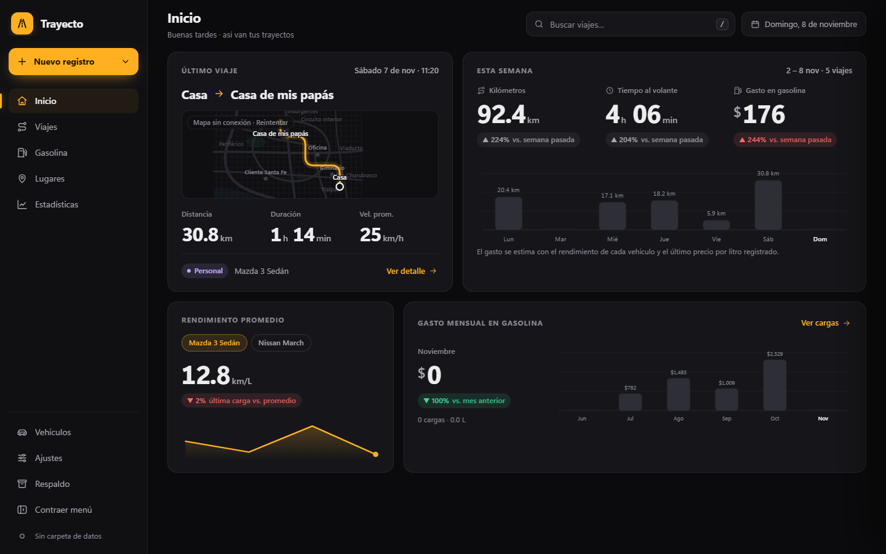
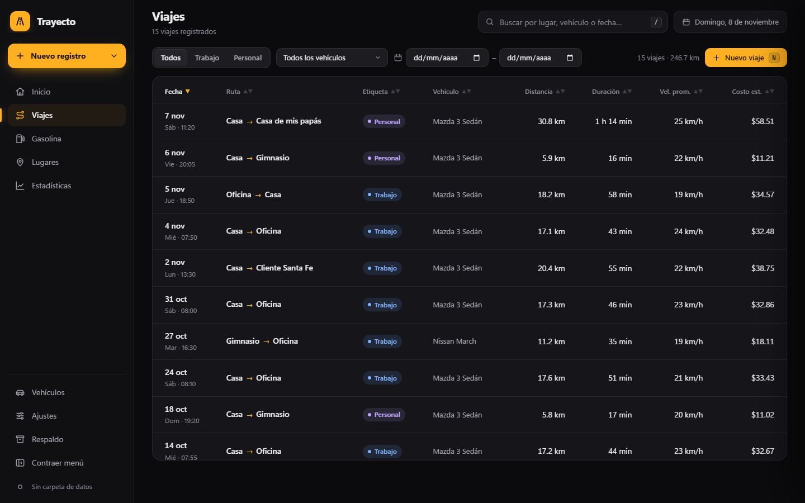
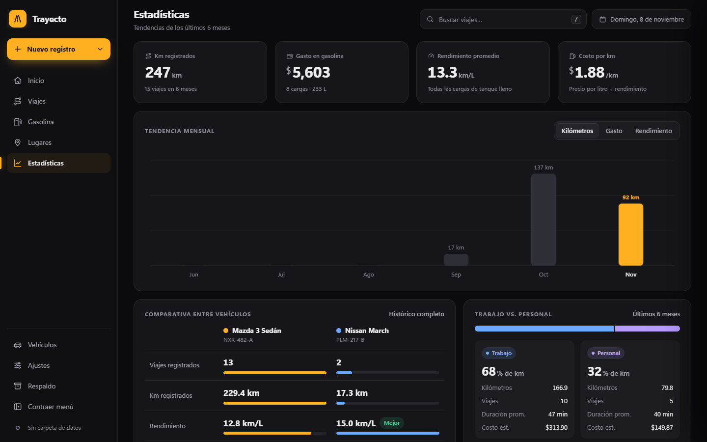

# Trayecto

Aplicación de escritorio **100 % local** para llevar el registro de tus **viajes en auto, cargas de gasolina y lugares frecuentes**. La interfaz está en español (es-MX) y tus datos nunca salen de tu equipo.

Se construye como **un solo archivo HTML autocontenido** (`dist/trayecto.html`) que se abre con doble clic, sin servidor ni instalación.



## Qué hace

- **Viajes:** registra origen, destino, distancia, duración y vehículo; calcula velocidad promedio y costo estimado.
- **Gasolina:** cargas, precio por litro y rendimiento (km/L) por vehículo.
- **Lugares:** sitios frecuentes con sus visitas y trayectos en un mapa.
- **Estadísticas:** resumen semanal y mensual de kilómetros, tiempo al volante y gasto.
- **Vehículos, ajustes y respaldo:** varios vehículos, respaldo y restauración en JSON.
- **Rutas por calles reales** dibujadas en los mapas; sin conexión, la app sigue funcionando con mapas SVG esquemáticos.

| Viajes | Estadísticas |
| --- | --- |
|  |  |

> Las capturas usan los datos de ejemplo que incluye la app; las ubicaciones son ficticias.

## Privacidad

Los datos se guardan en `localStorage` y, opcionalmente, en un archivo `trayecto-datos.json` dentro de una carpeta que tú eliges (Chrome/Edge). Lo único que usa internet son los mapas (MapLibre y OpenFreeMap) y el cálculo de rutas.

## Tecnologías

TypeScript (modo estricto) · Vite + `vite-plugin-singlefile` · MapLibre GL · Vitest · Playwright · ESLint + Prettier

## Cómo ejecutarlo

Requiere Node 22.

```bash
npm ci
npm run dev      # servidor de desarrollo
npm run build    # genera dist/trayecto.html
```

## Calidad

```bash
npm run check    # typecheck + lint + pruebas unitarias + build + pruebas E2E
```

Las pruebas E2E necesitan Chromium (`npx playwright install chromium`). El proyecto tiene cientos de pruebas unitarias y E2E, y una prueba de arquitectura que impide que las capas se importen entre sí de forma indebida.

## Arquitectura

Capas con dependencias en un solo sentido, vigiladas por ESLint y por `src/architecture.test.ts`:

```
shared  →  data  →  maps  →  features  →  app
```

Cada funcionalidad (`trips`, `fuel`, `places`, `vehicles`, `dashboard`, `stats`, `settings`, `backup`) tiene su repositorio, cálculos, formulario, vista y acciones. Más detalle en [`CLAUDE.md`](CLAUDE.md).
